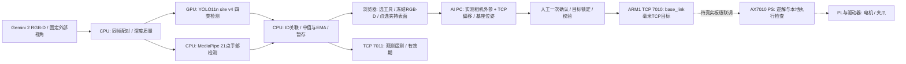

> 本文保留 AIPC 分册的责任范围。完整 FPGA 工程与指标现已并入本包；统一内容以 architecture.md、interface.md、requirement_mapping.md 为入口。

# AI PC 系统架构与数据流

本分册仅交付 AI PC；AX7010 PS/PL 的实现、逆解、时序/资源和真机结果由 FPGA 分册提供。
当前任务为桌面工具拾取，不包含递送到手。下面虚线表示待联调的物理执行边界。

NPU 未作为已运行推理后端；不为提高占用率而部署无关 LLM。YOLO 与手部模型并行，ROS 通过单独进程读取原子 JSON。
模型输出、RGB-D、TCP目标各有不同含义：检测框中心只是表面参考；点选表面经实测偏移才形成 TCP；没有有效外参时基座坐标为空。
实时滤波采用三点中值、EMA时间常数100ms、1.5mm死区、30mm突变拒绝。工具暂存350ms、手点200ms、手存在提示500ms。
暂存不能用于更新控制目标。发送后保存固定目标和实际ACK，漏检不发送零位置，不替换为其他同类物体。
这些时间参数是设计配置，不是测得的执行器响应延迟。
