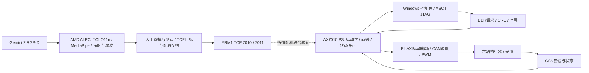

# 系统架构与数据流

AI PC 承担 RGB-D 采集、工具与手部检测、时间滤波、标定变换、任务目标确认和 UI。PS 承担运动学、路径和状态机；PL 承担 AXI 事务、CAN 帧调度/接收、独立 PWM 和服务超时。PL 有明确的自定义硬件逻辑和实现报告。

图中实线对应各自源码支持的链路，虚线是尚未由这两个输入包共同验证的接口适配。不能由合并文件推导“目标已物理执行”。各端详情见 aipc_architecture.md、fpga_architecture.md；跨端协议见 interface.md。
