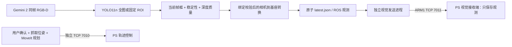

# 固定相机（眼在手外）视觉与 PS 接口

> R2状态说明：下文保留原技术记录与配置快照。用户已补充现场测试反馈，最新情况见 [现场更新](field_test_update.md)；请勿将历史“未测试/未固定”表述用于否定当前反馈。

> 2026-11-03：新增简化的 [桌面拾取 TCP 提交](simple_pickup.md)。`/workbench` 为新入口，原规划页迁至 `/planning`。TCP 7010 接收经一次确认的基座系末端目标；TCP 7011 仍仅传观测。

当前相机尚未固定。程序和模拟通信已经完善，**尚未完成真实相机到基座标定**。
相机与持续推理保持停止。后续的桌面强化训练与追踪升级见 temporal_tracking.md 和当前模型说明。
配置入口为 `config/vision_station.json`，默认 `camera_fixed=false`、`setup_id=null`、ROI 关闭。



视觉消息不会变成电机命令。检测框中心只是采样像素，不是夹爪位姿；
PS 视觉接收端没有 execute/upload/gripper 控制实现。

## 1. 安装位与坐标约定

- 相机光学坐标：x 向右、y 向下、z 向前；单位 m。
- 基座坐标：URDF `base_link`；不能直接套用光学坐标的方向。
- `p_base = T_base_camera @ [p_camera, 1]`，矩阵方向是相机到基座。
- 当前采用实测 3D 对应点求刚性变换，不需要电机接到主机，也不冒充已完成机器人运动采样手眼标定。
- 固定相机和基座后，为这一安装状态命名，例如 `desk_a_mount_01`，写入 station 的 setup_id。
  改变相机、基座安装或重新安装时，必须改变 setup_id 并重新标定。
  **setup_id 是人工维护的安装位标识，不能自动感知未报告的相机移动。**

运行时同时检查：schema 2、实测验证通过、eye_to_hand、坐标系、米制、相机序列号、
setup_id、camera_fixed、工厂内参与畸变/分辨率指纹。任一不匹配，不输出基座坐标。
旧 schema 1 外参即使写着 validated=true 也不能绕过这些检查。

## 2. 固定后开展标定

目前不要把 camera_fixed 或 physically_measured 改成 true 来跳过实际操作。
以后固定完成后按以下顺序执行：

1. 内参和打印棋盘检查沿用 `docs/vision_calibration.md`；RGB-D 对齐继续使用工厂参数。
2. 编辑 station：camera_fixed=true、实际 setup_id，保持真实图像尺寸。
3. 启动视觉采集（尚未标定时只产生相机坐标）。冻结一份原子 RGB-D，PNG 与深度来自同帧：

```bash
./scripts/start_vision.sh --headless
# 另开终端：必须有新鲜图像；输出路径不能已经存在
.venv-vision/bin/python scripts/calibrate_camera.py freeze \
  --output runtime/calibration/snapshots/marker_a.npz
.venv-vision/bin/python scripts/calibrate_camera.py sample \
  --input runtime/calibration/snapshots/marker_a.npz --pixel 320 240 \
  --output runtime/calibration/marker_a.json
```

`320 240` 只是命令格式示例，必须在冻结 PNG 上选择实际物理标记点，不能照抄。
freeze 拒绝超过 2 秒的旧快照；sample 可检查历史文件，但历史点不能替代新安装位的实测。
sample 输出有效深度比例、MAD、90–10 百分位跨度和 point_camera_m。
中心无效、有效比例低于 60%、MAD 超过 5 mm 或跨度超过 25 mm 会拒绝坐标。
这些检查不能证明一个薄工具的框中心落在工具而非桌面；采样类型会明确标注。

4. 复制 `config/calibration/correspondences.template.json`，将 point_camera_m 填入对应 camera_m，
   用测量工具取得**同一物理标记**的 base_m（米）。填写相机参数、序列号及安装位。
   最少 6 个拟合点，建议 10–15 个，覆盖桌面范围；另测至少 4 个不同位置验证点。
5. 真正完成测量后设置 camera_fixed/physically_measured=true。先检查报告：

```bash
.venv-vision/bin/python scripts/calibrate_camera.py extrinsics \
  --input runtime/calibration/measured_points.json --rms-mm 5 --max-mm 10
# 报告通过且 station 安装位一致后，才可安装外参（旧文件自动备份）
.venv-vision/bin/python scripts/calibrate_camera.py extrinsics \
  --input runtime/calibration/measured_points.json --rms-mm 5 --max-mm 10 --activate
```

求解在拟合点中做确定性 RANSAC + SVD，至少保留 6 点且 ≥75% 拟合点一致；报告排除点编号。
**验证点全部参与误差检查，不剔除失败验证点，也不参与拟合。**
重复点、共线/覆盖不足、单位异常、拟合验证点重用会拒绝。
默认验证 RMS≤5 mm、最大≤10 mm；这是软件验收门槛，不是精细抓取精度保证。
夹爪 TCP、工作空间、抓取朝向和碰撞场景仍需独立验证。

## 3. 识别稳定性与小目标 ROI

当前追踪已升级为有界暂存和三维滤波，见 [桌面目标与手部滤波](temporal_tracking.md)。
漏检最多暂存 350 ms；历史点显式标记，不能更新运动目标。坐标经过中值/EMA、死区和突变拒绝，
发送 camera XYZ 与通过安装绑定的 base XYZ。原始 DetectionStability 仅保留兼容测试，实时入口使用 TemporalTracker。

相机固定后可设置 `image_roi_xyxy: [x1,y1,x2,y2]`。模型只对桌面裁剪区域推理，
结果框会还原为**整幅原图坐标**，深度采样和标定仍使用原始同帧 RGB-D 与内参。
手部检测仍看完整画面。ROI 不是机械臂工作空间边界，也不是标定替代品。
当前未固定相机，实时 ROI 保持 null，不能沿用以前相机方向下的裁剪坐标。

已有单张验证照片的离线对比：

| 模式 | 正确/多余/漏检 | 平均框 IoU | 平均匹配置信度 |
|---|---|---:|---:|
| 全图 | 7 / 0 / 0 | 0.738 | 0.648 |
| 旧桌面图 ROI [150,130,600,340] | 7 / 0 / 0 | 0.887 | 0.704 |

ROI 根据这张照片选择，它已经参与过模型验证，不能当作新的独立准确率统计。
只证明该照片的小目标定位更贴合。没有新数据集证据，不能宣称总体准确率提升到某个百分比。
普通剪刀泛化和收纳盒场景的限制仍见 `models/tools_model_card.md`。
对比记录：`runtime/eye_to_hand/roi-offline.json`、`full.jpg`、`table_roi.jpg`。
复现可用 `scripts/evaluate_site_tools.py --roi 150 130 600 340`（其它参数同原评估脚本）。

## 4. 视觉通信的启动方法

PS 参考接收端仅用 Python 标准库。开发时本机模拟，默认绑定 loopback：

```bash
# 终端 1：独立视觉接收端，不占用 7010 轨迹接口
./scripts/start_ps_vision_simulator.sh --port 7011
# 终端 2：将来需要恢复实时视觉时，主进程自动管理独立发送子进程
./scripts/start_vision.sh --headless --ps-host 127.0.0.1 --ps-port 7011
```

如同时需要 ROS，先 source scripts/env_jazzy.bash，再给视觉命令加 --ros。
也可为已运行的视觉进程单独启动 `./scripts/start_vision_link.sh --host 127.0.0.1 --port 7011`；
两种发送方式任选一种，不要为同一个接收端重复启动。
真实 AX7010 的 Linux/IP/固件尚未落实；目前完成的是接收端参考实现和软件联调。
不要把本机 ACK 当作 PL/电机执行反馈。

发送上限默认 10 Hz，只转发新的、主机接收年龄小于 500 ms 的帧。
缺失、旧格式或过期结果会清空接收端观测；重连握手、确认 seq，重复帧不刷新 TTL。
接收端按本地单调时钟使观测到期，断线清空，不依赖两机墙钟完全相同。
该机制**未验证网络单程时延**，不是从曝光起计算的硬实时截止时间。
正式运动链路另需时钟同步/时延预算与独立 PL 保护；本通道不执行运动。

消息字段、校验与帧格式详见 `docs/AX7010_protocol.md`。

## 5. 已完成的验证

- 24 项测试：刚性变换方向、异常点、独立验证失败、安装位/分辨率失配、深度边缘、
  稳定性丢帧、TCP 帧校验、重复帧/TTL、断线清空，以及视觉与轨迹连接并行。
- 保存的真实 RGB-D 图片离线重放三次：7 个检测、7 个有效深度样本，PS ACK 3 帧；
  base_calibration_valid=false，基座坐标和抓取位姿保持 null。
- 三次重复图仅验证程序链路，不能证明真实视频稳定性或识别率。
  source_kind=offline_replay 与 live_camera 明确区分，报告保留原始拍摄时间。
- 旧实时快照 freeze 被正确拒绝；没有从历史图片伪造新安装位标定。

```bash
PYTHONPATH=vision:communication .venv-vision/bin/python -m unittest discover -s tests -v
YOLO_CONFIG_DIR=$PWD/runtime/ultralytics .venv-rocm/bin/python scripts/verify_vision_pipeline.py \
  --image datasets/site_tools/raw/flat_20261030_230838_589255/00003.png
```

离线联调报告：`runtime/eye_to_hand/pipeline-replay.json`。验证结束后模拟端自动退出，
不会开启相机、持续推理或真实电机。
