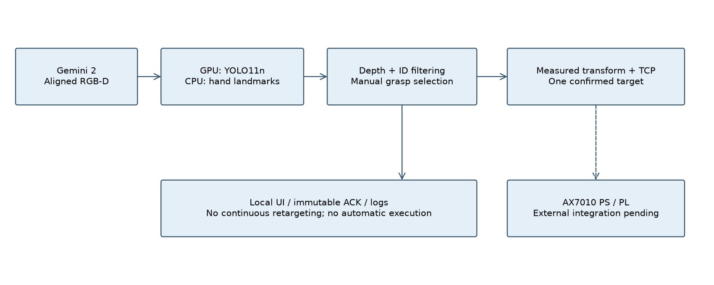
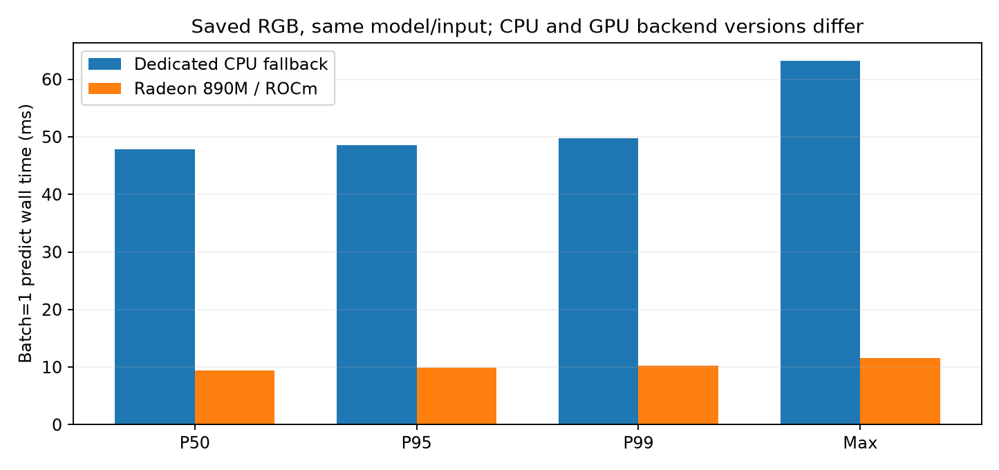
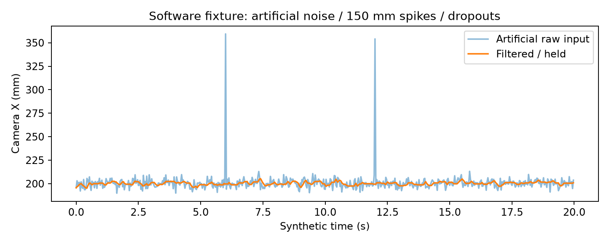

# 基于 AMD Ryzen AI PC 的桌面工具拾取系统
## AI PC 侧设计与测试分册

适用赛事：全国大学生嵌入式芯片与系统设计竞赛'2026 FPGA 创新设计赛道（AMD），3.2 具身智能赛道。
报告日期：2026-11-04；修订版 R2，加入用户现场测试反馈。当前范围：AI PC 本地感知、深度处理、目标生成、上位机与通信接口。团队/学校/成员信息并入总报告时填写。
本文及指标表由本机原始测试记录与用户补充的现场测试反馈生成，来源分别标注；FPGA板级测试、PS逆解性能及真实机械臂闭环成绩由团队另行提交，不在本分册给出。

## 1. 选题背景与作品定位

桌面常用工具取放需要识别细长、反光和外形相近的物体，并把二维检测转换成明确的三维夹持目标。本作品采用固定桌面、有限工具类别和眼在手外的RGB-D视觉，减少首期场景自由度。当前演示任务简化为“在桌面选定工具、确认夹持点、向下位机提交接近/抓取/抬升目标”；不包含工具递送到手或收纳盒竖放验收。

通用COCO类别不足以覆盖螺丝刀、钳子、镊子，单靠通用检测框也不能得到可执行夹爪位姿。项目选择YOLO11n进行现场微调，使用真实米制深度、按物体ID关联的有界滤波、实测外参绑定和一次确认后锁定目标。创新点主要在面向真实工位的系统集成、点位语义与异常处理，而非声称提出新的检测网络。

半自主流程保留人的任务选择和抓取位置确认。当前工具朝向采用每类实测固定抓取姿态，任意朝向自动抓取轴估计、自动夹持验证、真机闭环尚未完成。已有软件不意味着已经具备独立完成物理任务的能力。

## 2. 指南要求与本分册边界

依据用户提供的28页指南，重点对应3.2.2.3、3.2.3.1、3.2.4、3.2.5（印刷页10–18，PDF页13–21）。AI PC侧需要说明模型来源/版本/精度、运行后端、端侧收益、放弃方案、通信/时间/异常处理，并提供源码、依赖、部署步骤、指标表和原始证据。

五类核心指标中，本分册直接给出AI效果与推理性能；主机协议回环作为通信实现的补充证据。真实任务成功率、采集到执行器响应延迟、FPGA贡献、实际跨板通信应由联合测试完成。主机FPS、软件测试通过率、回环RTT都不能替代上述物理指标。R2新增用户反馈的30分钟现场感知吞吐、主机延迟、连续运行稳定性及各测点定位误差；同时保留RGB-D档案完整性及人工输入的滤波对照。

完整条款映射见docs/requirement_mapping.md。仅有AI PC分册不构成已经完成的整机闭环参赛作品。

## 3. 实际硬件与运行环境

| 项目 | 本机记录 |
| --- | --- |
| 整机DMI | Micro Computer (HK) Tech Limited / EliteMini Series / F8BNB |
| 处理器 | AMD Ryzen AI 9 HX 370 |
| GPU | AMD Radeon 890M Graphics / gfx1150 |
| 内存 | 28.98 GiB 操作系统可见；物理内存条标称容量待铭牌核对 |
| GPU可见共享内存 | 14.49 GiB；不是独立显存容量 |
| 操作系统/内核 | Ubuntu 24.04.2 LTS / 7.0.0-38-generic |
| 驱动 | 内核内置 amdgpu；不安装 amdgpu-dkms |
| ROCm / HIP | ROCm SDK包10.0.0；PyTorch 2.13.0+rocm10.0.0；实际HIP 7.15.26333 |
| 模型运行库 | Ultralytics 8.4.193 / MediaPipe 0.10.32 |
| 相机 | Orbbec Gemini 2；640×480彩色+对齐米制深度；本次不新开相机 |
| 功耗模式 | balanced；amd_pstate active；CPU governor powersave，不等于禁用睿频 |
| NPU | amdxdna可枚举，尚无已验证YOLO推理后端，未计入性能收益 |

指南要求ROCm 7.14.0及以上。这里分别列出AMD wheel/SDK版本与实际HIP版本，避免把PyTorch版本当驱动版本。版本证据见environment.json和host/deploy中的完整依赖锁文件。测试没有更换驱动、内核或系统Python。GPU负责YOLO，CPU负责相机/深度、MediaPipe、界面与通信，ROS如启用则保持独立系统Python进程。

## 4. 架构、数据流与模型选择

CPU接收同帧RGB-D；YOLO在GPU检测四类工具，MediaPipe在CPU独立检测每手21个关键点。二者可并行。每个候选点经深度有效率/离散程度检查，工具经ID关联和中值/EMA滤波后显示。人工在冻结同帧图上点选真实夹持表面，再用相机到基座的实测刚体变换和表面到TCP偏移生成基座目标。确认后固定目标，避免检测框抖动直接拖动机械臂。

四类定义为screwdriver、pliers、scissors、tweezers；scissors按项目任务包含用户的蓝色剪切钳。PCB及收纳盒竖放不是当前已验收类别/场景。手部模型的归一化z不作为真实距离，米制手点必须使用对齐深度。

YOLO11n的选择依据是轻量、可本地微调、支持ROCm PyTorch及现有任务类别；本次使用FP32。未把YOLO26 AMP辅助检查模型当主模型；本机AMP一致性检查曾失败，因此未强制使用FP16。NPU路线因运行时及计算验证未通过暂缓；FastFlowLM面向LLM，不能当作已验证的YOLO后端。云端识别未作为主流程，避免逐帧外发和网络依赖，但本次没有另做断网开机/路由器断连验收。

CPU fallback是可用的替代运行环境，本次独立测量。更大型YOLO模型尚未做同条件评测，不虚构其性能或否定结论。原LVGL/Tuya与当前AI PC流程无关，未纳入交付包。

端侧的具体收益包括图像和模型本地处理、无需逐帧云端API调用、可和本地TCP接口协同以及减少环境暴露。离线输入的GPU处理能力由本报告实测；真正现场延迟取决于相机、深度、UI、人为确认和下位机，不能由模型FPS倒推出完整抓取时间。

## 5. 数据、训练及模型效果

采用用户已有现场采集和已记录来源的公开训练数据。保留3个正常拍摄场次，共283张照片、7段录像，1145个可见工具框；误采51张/1段录像的场次已在此前删除，不恢复。63张新训练、96张新验证、124张新测试按整个拍摄场次划分；相邻帧及增强图不跨集合。训练总计1065张，验证204张，完整训练数据未全部附入本AI PC包，数据清单、训练参数与权重附带。

模型训练25轮，使用FP32、640输入、batch16、AdamW、lr0=0.0006，按验证集选择第21轮，不以测试集调阈值。本次重新评估固定124张/393框留出集，结果如下。

| 指标 | 本次结果 | 口径 |
| --- | --- | --- |
| mAP@0.5:0.95 | 82.08% | conf=.001 / NMS IoU=.7，Ultralytics内置AP |
| mAP@0.5 | 99.39% | 同上 |
| 固定阈值Precision | 96.75% | conf=.35 / NMS IoU=.45 / 匹配IoU≥.5 |
| 固定阈值Recall | 98.47% | 387 TP / 13 FP / 6 FN |
| 固定阈值F1 | 97.60% | 与AP排序指标不同 |
| 整图无误检无漏检 | 111/124 | 不能视为抓取成功率 |

| 类别 | TP | FP | FN | Precision | Recall |
| --- | --- | --- | --- | --- | --- |
| screwdriver | 73 | 4 | 0 | 94.81% | 100.00% |
| pliers | 124 | 0 | 0 | 100.00% | 100.00% |
| scissors | 123 | 1 | 0 | 99.19% | 100.00% |
| tweezers | 67 | 8 | 6 | 89.33% | 91.78% |

本次v4 mAP50–95为82.08%；历史v3同一留出集为64.51%。历史基线证据原样保留，未将其伪装成本次重新运行。两模型对比仅说明该批场景的进步。

三个场次来自同一批工具、相同时段和相近背景，整场留出仍不能证明跨日期、陌生工具、复杂遮挡或新工作台泛化。镊子仍有6个漏检/IoU未达标和8个误检；反光、细长目标与背景线条会影响检测和深度。没有关键点真值标注，因此手部只报告运行时间和检测到的手数，不给“关键点准确率”。

## 6. 测量方法与实测性能

模型性能采用单样本batch=1；预载124张真实测试RGB图、循环输入、20次预热后持续计时。图像解码不在模型单次计时范围内。CPU/GPU测试顺序运行，避免互相争用；首个CPU预测后重新设置torch线程为1，并记录实际值。GPU同步后用perf_counter_ns量整次调用，阶段耗时使用Ultralytics返回值。所有阶段按同一指标各自统计分位数，不能把几个P99相加当总P99。

CPU独立回退采用2.9.1+cpu，GPU采用2.13.0+rocm10.0.0；两者同模型、输入、阈值、线程，但软件后端版本不同。另附同ROCm发行版的CPU分支测量，不能把跨环境比较称为严格仅硬件差异消融。

| 阶段 / 范围 | P50 ms | P95 ms | P99 ms | 最大 ms |
| --- | --- | --- | --- | --- |
| GPU预处理 | 0.407 | 0.514 | 0.625 | 0.856 |
| GPU模型 | 8.313 | 8.631 | 8.788 | 9.410 |
| GPU后处理 | 0.472 | 0.870 | 1.075 | 2.139 |
| GPU整次predict | 9.460 | 9.836 | 10.210 | 11.515 |
| 独立CPU整次predict | 47.850 | 48.575 | 49.752 | 63.192 |
| 离线RGB-D处理 | 17.367 | 18.907 | 20.124 | 39.864 |
| 双手模型CPU | 19.680 | 24.384 | 24.633 | 24.839 |
| 主机回环RTT | 0.020 | 0.023 | 0.040 | 5.850 |

GPU单模型持续测量6280次、60.01秒，吞吐104.66帧/秒；独立CPU回退1249次、60.04秒，20.80帧/秒。这里是离线计算吞吐，不是摄像头实际输出或端到端系统FPS。

离线RGB-D流程重复同一张已保存的工具画面，包含并行YOLO/MediaPipe、深度采样、工具及手部滤波、框/点绘制、JSON和JPEG编码。共1819次、30.01秒，处理吞吐60.60帧/秒。该画面未检出手，不能用它代表双手进入场景的负载。它排除相机曝光/USB、原子文件及NPZ写入、浏览器流、ROS、有效实物外参变换和执行器响应。因此称“离线感知处理耗时”，不称指南定义的物理端到端延迟。

独立MediaPipe测试使用另一张固定含双手RGB图，预热20次后200次计时，每次检出2–2只手，不为该图编造深度。GPU张量峰值分配59.71MiB，进程RSS峰值2.14GiB；两者统计范围不同，不能相加当整机占用。

原始逐次时序：detector_gpu.csv、detector_cpu.csv、cpu_fallback.csv、offline_rgbd.csv、hand_model.csv。此前实时网页约30FPS的记录仅作历史材料，模型版本/场景不同，未拿来作为当前v4整链路验收。

## 7. 通信、时间约定与软件可靠性

AI PC接口采用ARM1封装的TCP报文，含长度、CRC32、递增seq和匹配ACK。7010提交一次确认的base_link毫米制TCP目标（含xyzw姿态和接近/抬升点），7011仅观测遥测。握手比较坐标/TCP/模型契约指纹，拒绝单位、坐标系、标定或目标ID不一致。接收目标不代表运动启动，页面没有自动电机执行路径。

本次通信测试在同一AI PC上创建临时127.0.0.1参考接收端，测量409340次请求/10.00秒。RTT由同一个单调时钟计算，无需跨机时钟同步。有效JSON双向合计吞吐7573.47KiB/s，超时0次、错误回包0次；不含网络头，不代表千兆链路吞吐，也不是实际AI PC到AX7010 RTT。

真实跨设备单向延迟尚无同步误差验收，本分册不填该数值。观测采用接收侧本地单调时钟累计有效期；收到旧帧、暂存点或断线时禁止把它当新目标。异常目标不自动切换到另一个同类工具。确认过的目标保留为历史记录，UI数值来自对应ACK，不由当前帧重新拼接。

软件回归本次71/71项通过，0失败、0错误，耗时4.06秒。覆盖变换方向、独立验证、单位/TCP/姿态/范围、目标移动/漏检/手部、CRC与分包、断连/看门狗、采集保存和会话划分等。这里是软件测试成功率，绝不是物理任务闭环成功率。

## 8. 视觉专项与稳定性补充

124张历史留出RGB-D全部通过尺寸匹配与RGB源哈希验证，配对完整性124/124。深度有效像素比均值97.19%，最小82.89%。有效定义是深度有限且在0.15–3m；不表示每个像素都满足定位精度，也不等于现场USB丢帧率。

人工滤波输入为seed73、4mm标准差噪声、2次150mm跳变和3帧漏检。稳定片段X标准差由4.023mm降为1.594mm，2次跳变拒绝2次，3帧漏检全部保留历史点但禁止更新目标。该结果验证软件滤波行为，不是机械臂定位精度或真实视频抖动实测。

此前自动采集的30/60秒级离线处理与10秒级回环记录不单独用于证明现场稳定性；本次30分钟现场稳定性结论来自下述用户测试反馈。此前离线测试期间有一次统计导出遇到NumPy整数不可JSON序列化，已修复测试脚本并保留错误日志；不把报表工具错误计作视觉任务漏检，也不掩盖该失败过程。AP采用Ultralytics内置结果，未使用缺失的外部faster-coco-eval评估器；复测脚本关闭该可选导出路径。

## 9. 现场测试补充、定位表现与改进方向

根据用户于2026-11-04补充的实际测试反馈，现场感知吞吐、主机感知延迟和30分钟稳定性已满足前述目标；定位结果以各测点约5–8mm表述。该部分可作为现场测试反馈写入分册，来源记录在metrics/evidence/field_test_feedback.json及.md。用户未提供精确分位数、逐帧/逐点原始记录、现场软件配置快照和基准测量方法，因此保留反馈的界限值，不把原阈值当成精确测量点值，也不补造采样次数或波形。

| 现场项目 | 用户测试反馈 | 当前结论 |
| --- | --- | --- |
| 完整感知吞吐 | ≥25帧/秒，连续30分钟 | 用户反馈达标；精确FPS未提供 |
| 主机感知延迟 | P95≤50ms / P99≤80ms / 最大≤150ms | 用户反馈达标；不含执行器响应 |
| 持续运行稳定性 | 30分钟异常0次、人工重启0次 | 用户反馈达标；不外推更长时间 |
| 三维定位 | 各测点误差约5–8mm，未计算RMS | 记录测点误差范围，不宣称RMS≤5mm |

定位误差的最大报告范围约8mm，低于原10mm上限；但不能据此判定RMS≤5mm。若各点误差均不低于5mm且存在大于5mm的点，该组误差的RMS就大于5mm。范围中点6.5mm既不是已测均值，也不是RMS，不在报告中作为统计值填写。定位性能以“各测点约5–8mm”作为当前反馈，原RMS≤5mm保留为精度优化目标。是否足以稳定夹取细镊子，仍需结合工具尺寸、夹爪有效容差与实际抓取试验判断。

本修订将工作重点由单纯提高离线FPS，转向定位误差来源与实际夹持容差：固定相机和基座后复核整个工作区的独立标记点；分别检查工厂深度、相机到基座外参、基座原点/轴和末端TCP偏移。测点应覆盖近/远、左/右及不同高度，保存真实参考坐标与估计坐标，逐点计算三维距离误差，再报告RMS、P95和最大值。反光/薄工具边缘须检查深度质量与表面点选择；保留现有滤波和目标锁定，避免仅靠加大平滑掩盖系统性偏移。这些是下一步优化方法，不声称本轮已经修改算法或实现更小误差。

交付包中的软件/标定配置仍是原工程快照：camera_fixed=false、实物外参/TCP/工作区未激活。用户现场标定参数尚未提供或回填，所以该快照状态不再被描述成用户当前现场一定未固定。真实部署应导入与现场对应的setup_id、外参和TCP配置并复核，不能只把validated改成true。主机原工程保持不动，本次仅更新报告与交付证据。

手部关键点精度、任意朝向自动抓取准确率、整机功耗及新工作台泛化尚无新增数据。实际跨板通信和物理任务闭环仍由联合测试提供，不能由这次主机现场反馈推定通过。剩余验收/改进项见metrics/acceptance_targets.csv；已反馈达标的吞吐、延迟和稳定性不再列为未测试目标。

## 10. 从交付包复现

目录主入口readme.md。host/app保留源码相对路径，models、config和测试数据放在应用根下，避免移动模块导致路径失效。host/deploy提供隔离安装、网页启动和顺序复测脚本。原工程未修改，副本内默认标定仍无效，目标端为本机回环。

步骤：①使用Ubuntu24.04/Python3.12及已核验的AMD GPU内核驱动；②按readme安装uv后运行host/deploy/setup.sh gpu；③核查models/manifest.json与环境日志；④运行host/deploy/retest.sh生成新目录，比较AP、固定阈值结果及分位数；⑤启动run_dashboard.sh查看界面；⑥需要现场采集时再由操作者主动启用相机；⑦真实坐标启用前导入经验证的现场标定参数，并核对PS坐标契约。R2的现场反馈不能代替这些参数文件。

依赖安装需要联网访问对应AMD/PyPI索引，包内不包含数GB环境和完整训练集。提供锁定版本和已有安装脚本，但未声称已在第二台全新机器完成部署。目录副本中的测试运行与重新安装整个环境不是同一件事。

## 11. 可复用经验与交付清单

已整理的工作流包括GPU/ROS隔离、RGB-D到TCP接口、目标有界暂存、按场次留出、证据生成和包完整性校验。适用条件、使用方法、观察到的失败和边界见skill/readme.md；尚未声称跨设备迁移加分验收通过。

交付包含本报告的DOCX/PDF/Markdown、指定表头metrics.csv、逐次CSV/JSON/测试日志、统计图、AI PC源码/配置/模型、完整124图留出RGB-D与标注、模型来源/训练记录、部署和复测脚本、指南条款映射与文件SHA256清单。FPGA工程、时序/资源或物理闭环数值不在本分册中制作。

## 附录：参考材料

[1] 用户提供《全国大学生嵌入式芯片与系统设计竞赛'2026 FPGA赛道选题指南（AMD）》，28页；本包docs/amd_contest_guide_2026.pdf，来源哈希见guide_source.json。
[2] 现场模型、训练/验证划分、来源与许可：host/model/model.md、host/app/models/manifest.json、data/provenance。
[3] 本机测量与脚本：metrics/logs、metrics/scripts；历史对比：metrics/historical。现场反馈：metrics/evidence/field_test_feedback.json及.md。各来源分别记录，报告与metrics表由相应记录生成。

## 附录：AI PC 剩余验收及精度优化目标（非新增实测成绩）

| 项目 | 具体设计目标 | 单位 | 方法 | 依据与边界 |
| --- | --- | --- | --- | --- |
| 实物基座定位RMS | <=5 | mm | 保存独立测点参考XYZ与估计XYZ，以三维距离计算RMS、P95和最大值 | 用户反馈各点约5–8mm且未计算RMS；该目标未判定达标，需精度优化与复测 |
| 未见工作台工具检测mAP50–95 | >=75 | % | 新日期/新摆放完整留出不少于200图；禁止训练或调阈值 | 迁移验收目标，暂无新数据 |
| 干净环境部署 | 1/1 且安装后验证<=60 | 次 / 分钟 | 相同硬件新系统；时间不含软件包下载；记录完整安装日志 | 复现目标，未在新机器验收 |
